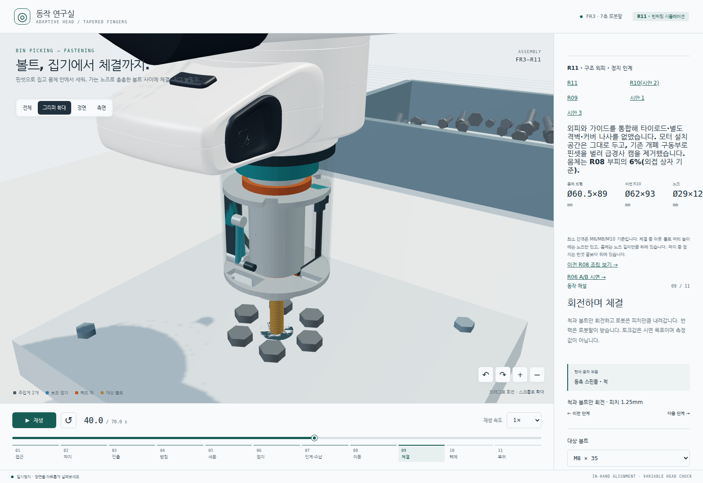
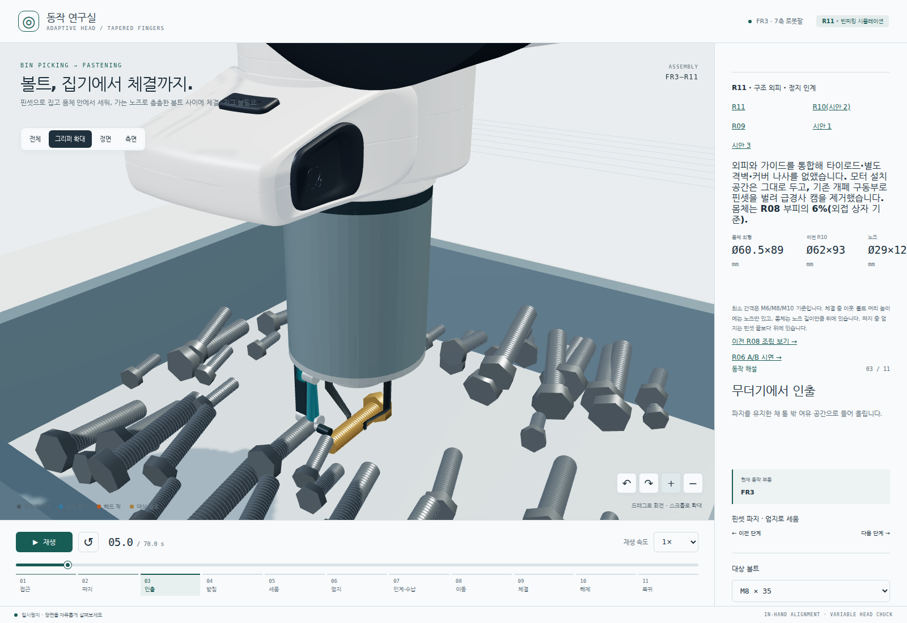
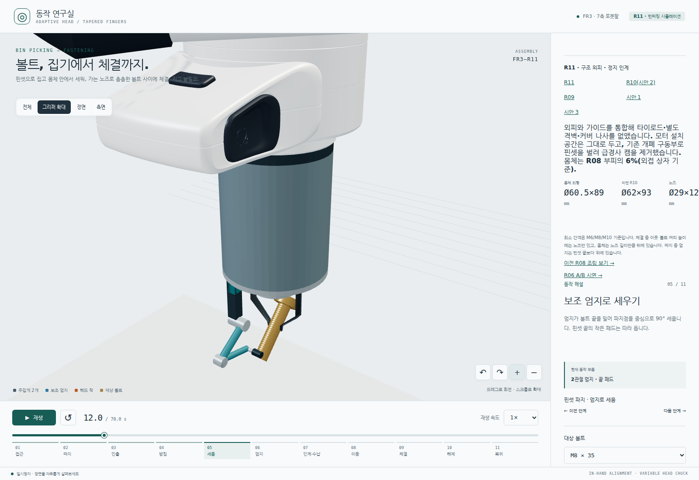
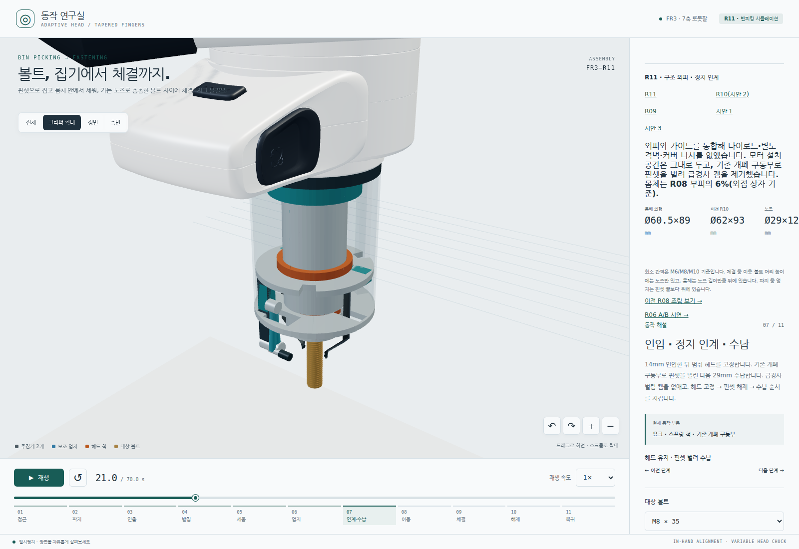
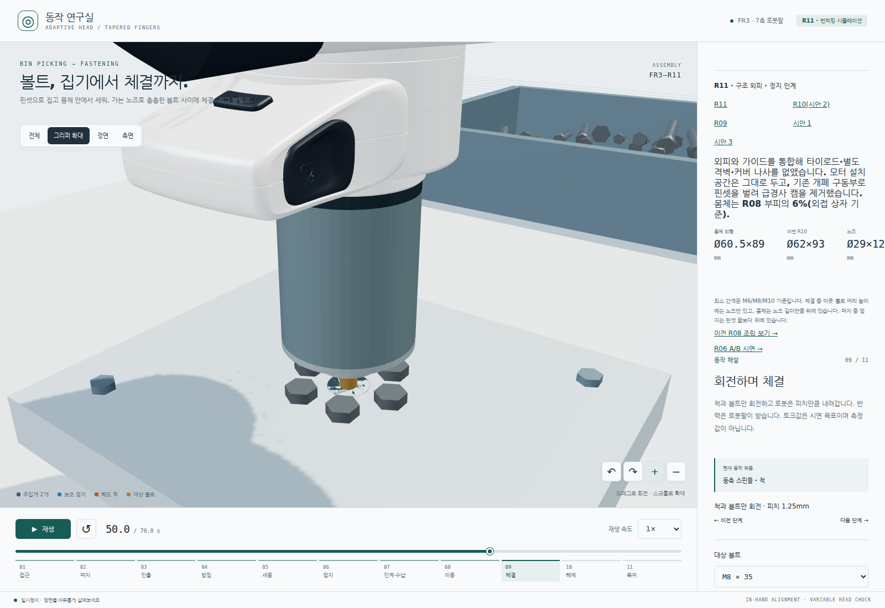
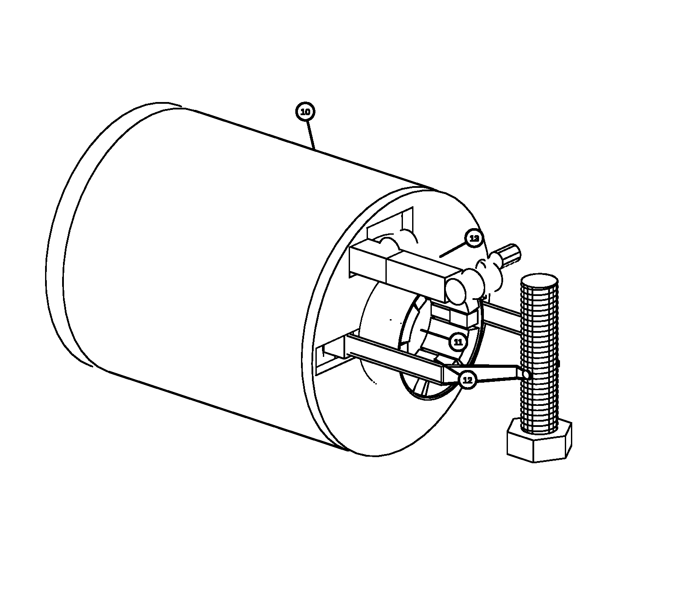

# 볼트 그리퍼 R11 — 특허 출원 가능성 확인용

> **이 저장소는 볼트 그리퍼의 특허 출원 가능성을 확인하기 위한 검토용 저장소입니다.**
> 그리퍼의 구조와 동작을 3D 애니메이션, 설계 기록, 도면 초안으로 정리합니다. 특허성 판단은 미확정이며, 아래 검토 항목은 발명의 차별점을 검토하기 위한 후보입니다.



*R11 구현 당시 원본 캡처(2026-10-02). 외장을 투명하게 표시한 내부 배치이며 단면도는 아닙니다.*

## 무엇을 하는 그리퍼인가

무더기 속에 가로로 놓인 육각 헤드 볼트를 얇은 핀셋으로 집고 보조 엄지로 세운 뒤 본체 안의 척에 넘겨 체결하는 그리퍼 개념입니다. 파지부터 정렬·인계·체결까지 하나의 말단장치에서 이어지는 구조를 검토합니다.

현재 버전은 **R11**입니다. 브라우저에서 Franka FR3에 장착한 모습을 재생하며 M6×20, M8×35, M10×50을 선택할 수 있습니다. ROS나 Gazebo 없이 실행합니다. 애니메이션의 70초 사이클은 동작 설명용 예시이며 실물 생산 주기 측정값이 아닙니다.

## 구조

| 구성 | 역할 |
| --- | --- |
| 얇은 핀셋 팁 | 볼트 사이로 들어가 몸통을 파지 |
| 2R 보조 엄지 | 파지한 볼트를 90° 회전시켜 세움 |
| 축방향 이송부·요크 | 볼트를 본체로 14 mm 인입하고 핀셋을 수납 |
| 방사형 6조 척 | 육각 헤드를 받아 고정하고 회전 전달 |
| 가는 노즈 | 이웃 볼트가 있는 체결 위치에 접근; Ø29 × 12 mm |
| 구조 튜브·가이드 | 외피와 가이드를 통합해 본체 구성; 외형 Ø60.5 × 89 mm |

R11은 척 인계 위치에서 축방향 이송을 잠시 멈춥니다. 이 정지 구간에서 기존 개폐 구동기로 핀셋을 벌린 다음 수납을 이어갑니다. R10의 급경사 벌림 캠을 제거한 변경이며 지령 축 5개와 화면 단계 11개를 유지합니다.

척과 볼트가 회전하고 로봇팔이 나사 피치에 맞춰 내려가는 체결 동작을 표현합니다. 반력 토크는 로봇팔이 받는 구성으로, FR3 시연이 실제 체결 토크의 수용 가능성을 입증하지는 않습니다.

## 동작 과정


화면에서는 접근 → 파지 → 인출 → 받침 → 세움 → 엄지 → 인계·수납 → 이동 → 체결 → 해제 → 복귀의 11단계로 표시합니다.

| 1. 파지 | 2. 엄지로 세우기 |
| --- | --- |
|  |  |
| 3. 척에 정지 인계 | 4. 체결 |
|  |  |

*위 그림은 2026-10-02 R11 구현 당시 원본 캡처입니다. 버전·시각·규격·원본/재현 구분은 [캡처 목록](archive/R11/screenshot-manifest.json)에 기록되어 있습니다.*

## 특허 검토용 도면과 확인할 항목

[도면 초안 PDF(3쪽)](archive/R11/patent-drawings/R11-patent-drawing-draft.pdf) · [도면 설명과 파일 목록](archive/R11/patent-drawings/README.md)



도면은 조립 외관, 작업단 정면, 내부 배치, 파지부터 체결까지의 동작 순서를 담습니다. PDF와 PNG는 R11 모델을 바탕으로 만든 검토용 선화 초안입니다.

특허 출원 가능성 검토에서는 다음 구조와 순서의 조합을 살펴봅니다. 각 항목의 신규성·진보성이나 권리 범위는 아직 판단하지 않았습니다.

- 핀셋 파지와 보조 엄지의 90° 정렬을 하나의 본체에 배치한 구조
- 몸통 파지에서 헤드 척 고정으로 넘어가는 인계와 핀셋 수납 순서
- 축방향 정지 구간에서 기존 개폐 구동기로 핀셋을 벌리는 구성
- 가는 노즈를 통해 이웃 볼트가 있는 위치에서 체결하는 배치
- 외피·가이드 통합과 요크 변경이 파지·인계 동작에 미치는 영향

이 저장소의 자료는 구조를 설명하고 비교하는 근거로 사용합니다. 선행기술과의 청구항 대조, 실제 구동부 구성, 실시 가능한 상세 설계는 추가 검토가 필요합니다.

## R10에서 R11로 바뀐 점

| 항목 | R10 | R11 |
| --- | --- | --- |
| 본체 외형 | Ø62 × 93 mm | Ø60.5 × 89 mm |
| 수납 행정 | 32 mm | 29 mm |
| 지정 외피·프레임·요크 재료 체적 | 57,796.93 mm³ | 41,794.86 mm³ (−27.69 %) |
| 핀셋 벌림 | 수납 시작 시 급경사 캠 | 축방향 정지 구간에서 기존 구동기로 개폐 |

체적 감소는 **지정한 구조 솔리드만** 비교한 모델 계산값입니다. 전체 조립체 질량 감소나 강도 확보를 뜻하지 않습니다. 구동기·감속기·케이블 등은 이 체적 비교에서 제외했습니다. 계산 기준과 미확정 항목은 [R11 설계 기록](R11.md)에 정리했습니다.

## 애니메이션 실행

Node.js 22.12 이상이 필요합니다.

```bash
npm ci
npm run dev
```

브라우저에서 `http://127.0.0.1:5173/`을 엽니다. FR3 메시·관절 데이터와 비교용 Robotiq 자산을 이 저장소에 포함하므로 기존 ROS 프로젝트를 설치할 필요가 없습니다.

- 재생·일시정지·타임라인으로 각 동작을 확인합니다.
- 전체·그리퍼 확대·정면·측면 보기로 구조를 살펴봅니다.
- 외장 투명화·부품 이름표·분해 보기로 내부 배치를 확인합니다.
- M6×20 / M8×35 / M10×50을 선택해 규격별 동작을 비교합니다.
- R09와 R10 시안은 화면의 버전 링크에서 전환합니다. R08은 `integrated.html`, R07은 `engineering.html`, R06은 `concept.html`에서 엽니다.

정적 배포 파일은 `npm run build`로 `dist/`에 생성하며 `npm run preview`로 확인합니다. HTTP 서버로 열어야 모델을 불러올 수 있습니다.

## 검증 범위

```bash
npm test
npm run typecheck
npm run build
# 브라우저 설치 후 실행
npx playwright install chromium
npm run test:browser
```

단위검사와 브라우저 검사는 기구학·배치 로직 및 화면 동작을 확인합니다. 실제 파지·접촉·마찰·충돌·체결 성능을 검증하지 않습니다.

모터·감속기·베어링 선정, 스프링·래치·해제 로드의 힘 전달, 얇은 외피와 요크의 강도·강성, 제조 공차와 배선은 미확정입니다. 일부 구동기 설치공간은 모델에서 서로 겹치며 실제 장착 가능성이 확인되지 않았습니다. **현재 모델과 도면은 제작 승인 자료가 아닙니다.**

## 자료 구성

웹 실행에 필요한 코드·자산과 설계 문서·도면·설명용 그림을 포함합니다. 이전 버전 전체 소스 아카이브, 압축 파일, 조립 모델 내보내기와 별도 검토 로그는 포함하지 않습니다. 원본은 `robot_arm` 저장소의 `f8d74569c0e01be598fe87f3d76fff89739a832a` 커밋에 보존되어 있습니다.

| 경로 | 내용 |
| --- | --- |
| `src/`, `scripts/`, `tests/` | 브라우저 애니메이션·기구학·자산 준비·기존 검사 |
| `assets/fr3/` | 독립 실행에 필요한 FR3 메시·관절 YAML·라이선스 |
| `assets/robotiq-2f85/` | 이전 비교 모델 자산과 출처 |
| [R11.md](R11.md) | 현재 버전의 설계 목적·변경·계산·한계 |
| [R10.md](R10.md), [R09.md](R09.md), [R08.md](R08.md), [R06.md](R06.md) | 버전별 설계 기록 |
| `archive/R11/` | R11 도면과 README 설명용 원본 캡처 |

## 라이선스와 출처

코드는 원본 프로젝트의 [Apache-2.0 라이선스](LICENSE)를 따르며 [NOTICE](NOTICE)를 보존합니다. FR3 자산은 Franka Robotics GmbH 및 기여자의 Apache-2.0 저작물입니다. 이전 비교용 Robotiq 2F-85 자산은 PickNik Robotics 패키지에서 가져온 BSD-3-Clause 저작물이며 자체 LICENSE·NOTICE를 포함합니다. Three.js와 기타 의존성은 각 패키지 라이선스를 따릅니다.
