# 볼트 그리퍼 A–G 구조 검토

검토 기준일: 2026-10-14

## 설계 목적과 범위

볼트가 자세 전환 중 빠지지 않도록 잡고 머리를 체결부에 넘긴 뒤 구멍 축에 맞춰 가체결하는 구조를 검토한다. 목표는 머리가 작업면에 도달한 모습까지이며 추가 조임으로 축력을 만드는 본체결은 포함하지 않는다. A–F는 각 개선점을 비교하는 여섯 안이며 G는 통합안이다. 모든 안은 Ø140×210 mm 개념 몸체, 측면 모터, 분리된 머리 홀더와 구동축을 공유한다. 외장 카메라와 돌출 집게는 몸체 치수에 포함하지 않는다. 인입·수납 가이드, 베어링과 축 고정, 벨트 전달부를 함께 배치할 공간을 확보하기 위해 몸체 기준을 정했다.

현재 구조의 기준은 [revision-config.ts](../src/revision-config.ts), [revision-motion.ts](../src/revision-motion.ts), [revision-model.ts](../src/revision-model.ts), [revision-grip.ts](../src/revision-grip.ts), [revision-head-drive.ts](../src/revision-head-drive.ts), [revision-scene.ts](../src/revision-scene.ts)다. 화면은 [main.ts](../src/main.ts)와 [revision-viewer.ts](../src/revision-viewer.ts)에 정의되어 있다. 아래에서 제조사 사례, 자체 계산, 모델에 표현한 구조와 실물에서 확인할 조건을 구분한다.

모델은 설계 순서를 설명하는 운동학 애니메이션이다. 중력 회전에는 단순 진자 근사를 쓰지만 접촉·마찰·변형을 푸는 조립 시뮬레이터는 아니다. 실제 영상 인식, 센서 입력, 로봇 제어와 체결 합격 판정은 구현하지 않았다. 수치와 사진은 제작 승인이나 실기 성공의 근거로 사용할 수 없다.

## 가체결 제품안 비교와 선택 기준

[두 배치를 같은 축척으로 비교](https://glory-legend.github.io/Patent_robotarm-gripper/comparison.html)할 수 있다. 두 안 모두 원형 몸체와 아래쪽 집게라는 원안의 구성을 유지한다. 몸체 치수는 구매 부품 선정 전의 공간 배치 기준이다.

| 항목                     | 소형 모듈형                         | 확장 통합형                               |
| ------------------------ | ----------------------------------- | ----------------------------------------- |
| 몸체 배치                | Ø96×180 mm                          | Ø140×210 mm                               |
| 원안 Ø78×148 mm와의 차이 | 지름 +18 mm, 길이 +32 mm            | 지름 +62 mm, 길이 +62 mm                  |
| 회전 구동                | 동축 감속 스핀들 배치               | 측면 모터·벨트·중공축                     |
| 규격 전환                | M8 기준, 소켓·비트·파지 부품 교환   | M6·M8·M10 프리셋, 실물은 규격별 부품 교환 |
| 슈 복귀                  | 고정 복귀 캠과 수동 회전축의 배치안 | 서보·클러치·인덱스 핀                     |
| 웹 표현                  | 내부 공간·지지·단면·분해            | A–G별 동작·단면·분해                      |

가체결용 첫 시제품은 소형 모듈형을 우선한다. 한 번에 쓰는 볼트 규격과 헤드를 정하고 규격이 바뀌면 카트리지를 교환하는 타협으로 몸체를 줄인다. 소형안의 중력 회전·캠 복귀는 전체 행정의 간섭과 마찰을 확인하기 전까지 확정 구조로 보지 않는다. M6의 작은 중력토크로 안정적인 회전이 어렵다면 중력 회전 대신 작은 회전축 구동기를 쓰는 편이 합리적이다.

가체결도 나사산이 비뚤게 들어가거나 비트가 홈에서 뜨면 실패한다. 비트의 상대 착좌 깊이, 축방향 변위, 회전각·전류를 함께 읽고 머리가 작업면에 도달하면 추가 조임 없이 정지한다. 공구를 빼기 전에는 볼트가 작업물에 남는지 확인한다. 종료 힘·토크와 재시도 횟수는 실물 시험으로 정하며 화면의 압축량을 센서 합격값으로 사용하지 않는다.

DEPRAG의 E-SFM은 교환 가능한 노즈와 힘·속도·위치 조정, 깊이 감지를 조합한다. 이 구성은 교환식 끝단과 센서 기반 가체결 제어의 참고 사례다. 해당 상용 모듈이 이 두 몸체 안에 들어간다는 뜻은 아니다. [제조사 모듈 설명](https://www.deprag.com/en/automation/screwdriving-units/e-sfm.html)

FR3의 손목 관절 5–7에는 최대 12 N·m 한계가 제시돼 있다. 이 수치를 가체결 허용 토크로 그대로 사용하지 않는다. 초기 문서의 8·20·40 N·m는 제품 정격에서 제외한다. 향후 본체결까지 확대할 때는 로봇 자세별 반력과 외부 반력 지지 구조를 다시 검토해야 한다. [Franka 관절 한계](https://frankarobotics.github.io/docs/robot_specifications.html)

원안 백업 기준은 커밋 `493dcc393c3dd2bc35226e2cea2461d4539cd616`이다. 변경 전 소스와 수정 중 소스를 별도 압축 파일로 보존하고 SHA-256으로 확인했다. 아래 비교 사진은 현재 코드로 재현한 배치안이며 원안의 당시 사진과 구분한다.

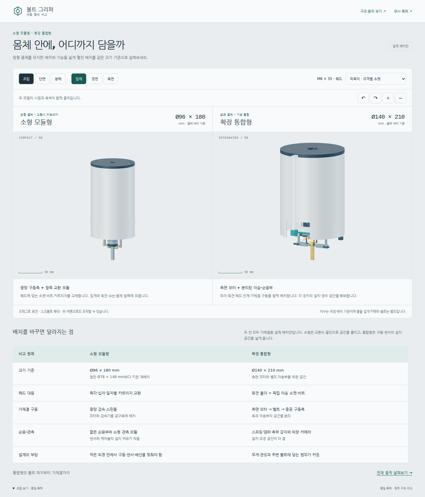

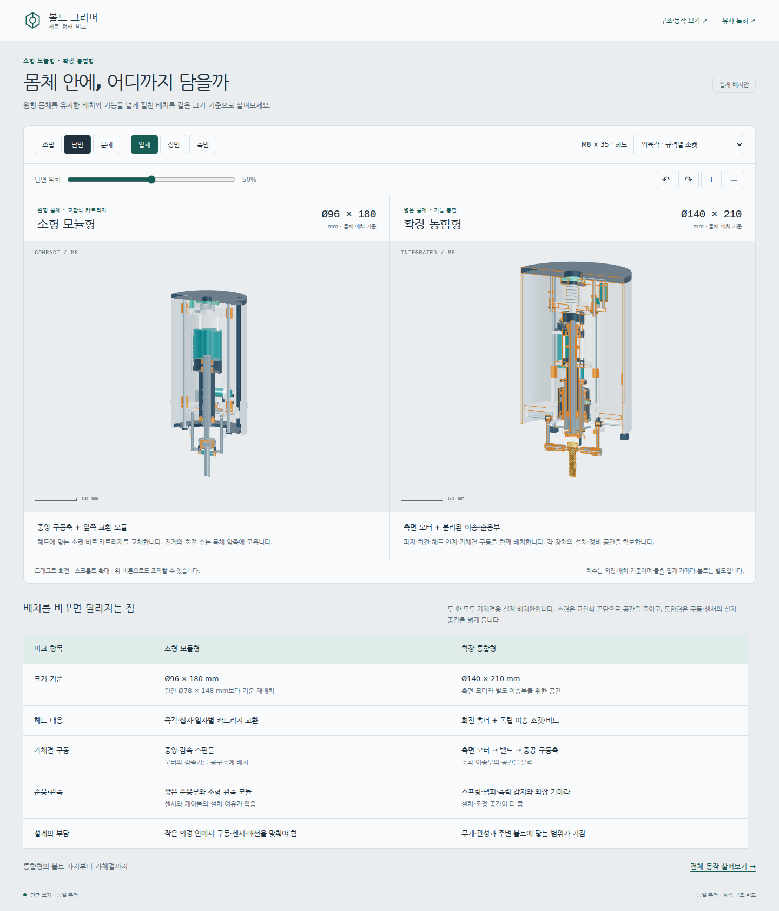

## 버전 구성과 사진

| 안             | 적용 구조                                       | 다른 안과의 관계                             | 비교할 부분               |
| -------------- | ----------------------------------------------- | -------------------------------------------- | ------------------------- |
| A `head`       | 육각 소켓, 머리 밑 유지턱                       | 공통 몸체에 머리 유지 구조 추가              | 토크 전달과 축방향 유지   |
| B `retention`  | U형 회전 슈, 걸림턱, 인덱스 핀, 회전축 서보     | 회전축 서보로 세움                           | 회전 중 접촉과 유지       |
| C `compliance` | 축방향 가이드·스프링·스톱·힘/변위 감지          | 공통 구동부에 순응부 추가                    | 축력 감지와 과행정        |
| D `damping`    | 스프링과 병렬 축방향 댐퍼                       | 복귀 스프링과 가이드도 포함                  | 접촉 충격과 복귀 진동     |
| E `gravity`    | ㄴ자 집게, 중력 회전, 수직 보정과 원점 복귀     | B의 유지 구조 포함, 클러치 해제 후 중력 회전 | 작은 중력토크와 반복 복귀 |
| F `drive`      | 카메라·조명, 독립 비트 이송·회전, 홀더 브레이크 | A의 머리 유지 구조 포함                      | 홈 관측과 비트 착좌       |
| G `integrated` | A–F 통합                                        | 인계·잠금·해제 순서 통합                     | 전체 동작과 하중 경로     |

아래 A–G 사진은 **2026-10-14 현재 코드를 재현한 캡처**다. R11의 **2026-10-02 당시 원본 캡처**는 [보관 폴더](../archive/R11/screenshots)에 별도로 남아 있다. 현재 재현 사진을 이전 버전의 원본 사진으로 취급하지 않는다.

| A 헤드 고정형                                    | B 회전 파지형                                         |
| ------------------------------------------------ | ----------------------------------------------------- |
| 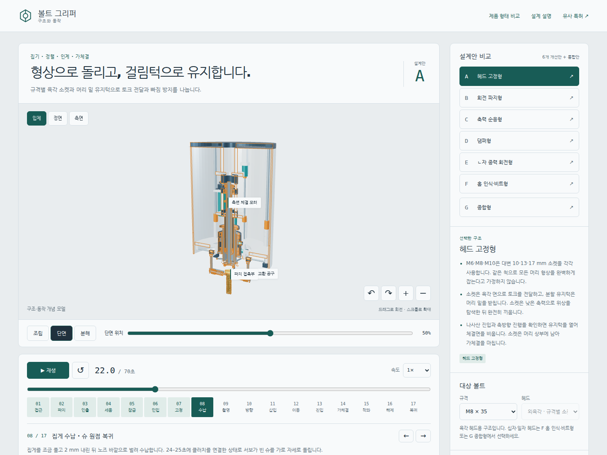 | 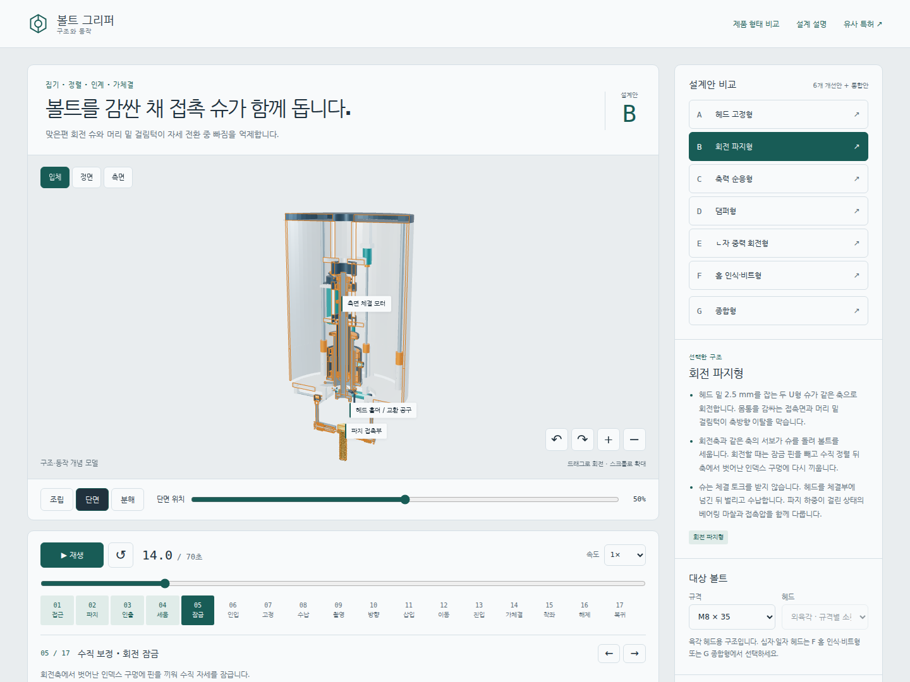 |

| C 축력 순응형                                          | D 댐퍼형                                       |
| ------------------------------------------------------ | ---------------------------------------------- |
| 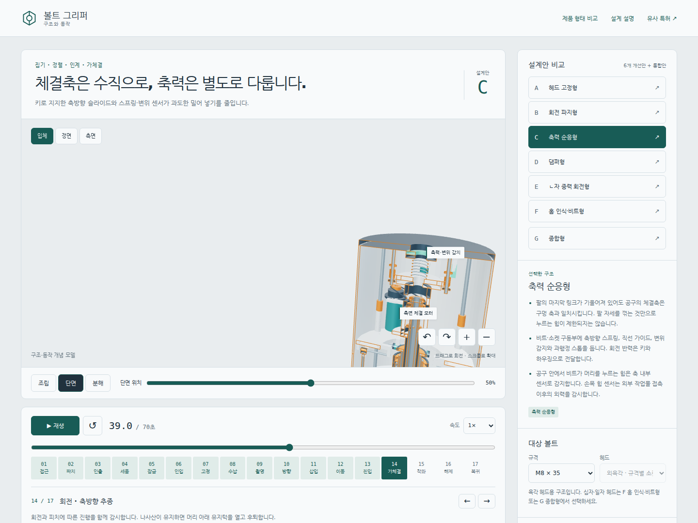 | 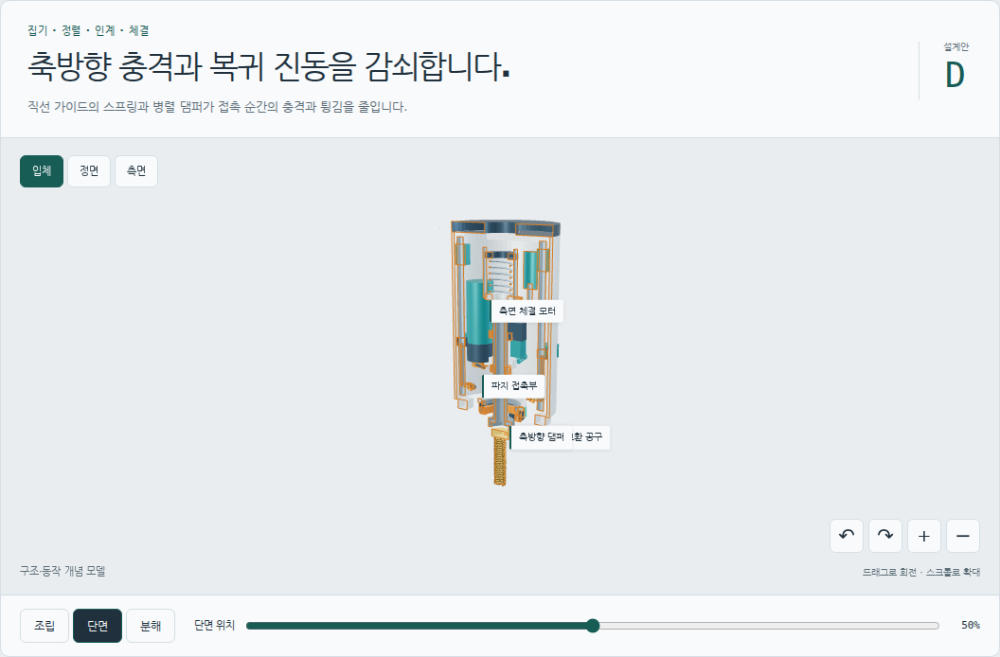 |

| E ㄴ자 중력 회전형                                       | F 홈 인식·비트형                                     |
| -------------------------------------------------------- | ---------------------------------------------------- |
| 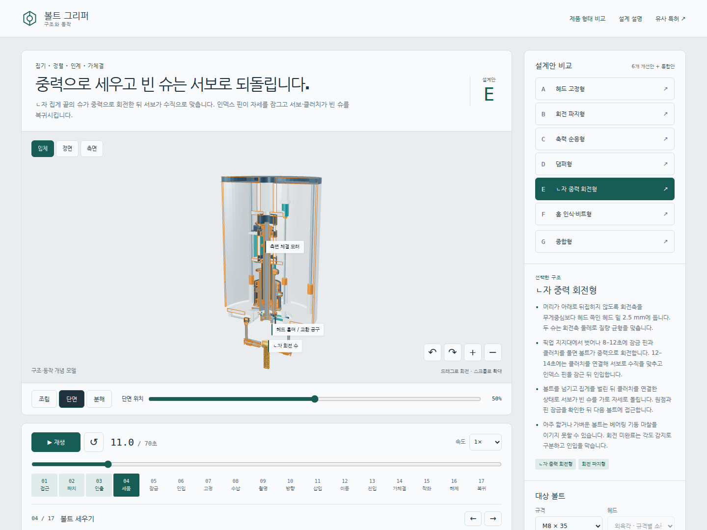 | 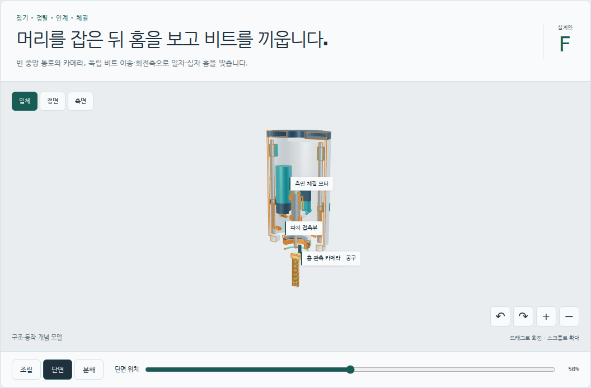 |

| G 조립                                              | G 단면                                            | G 분해                                             |
| --------------------------------------------------- | ------------------------------------------------- | -------------------------------------------------- |
| 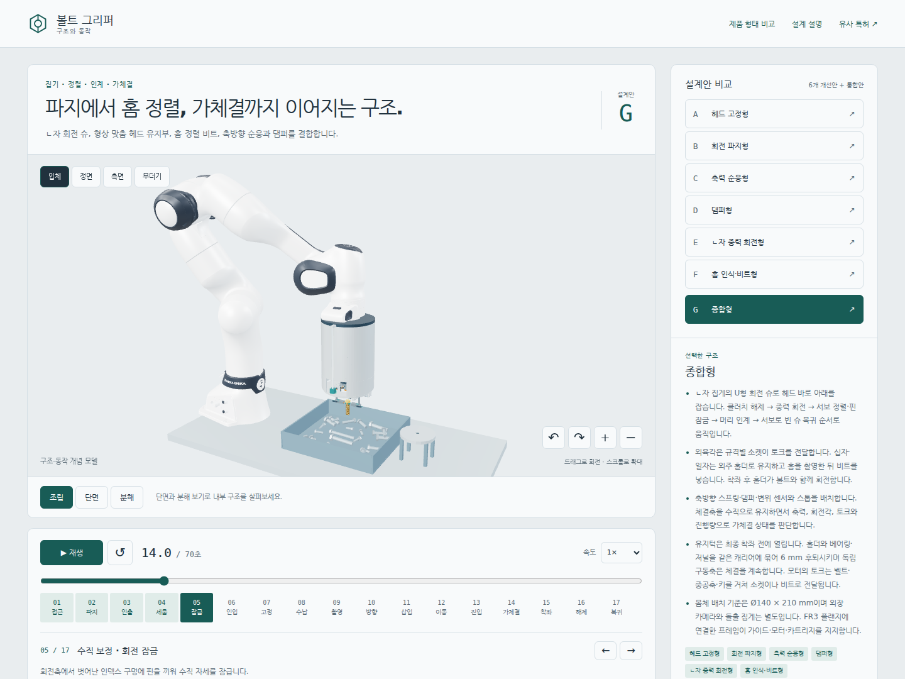 | 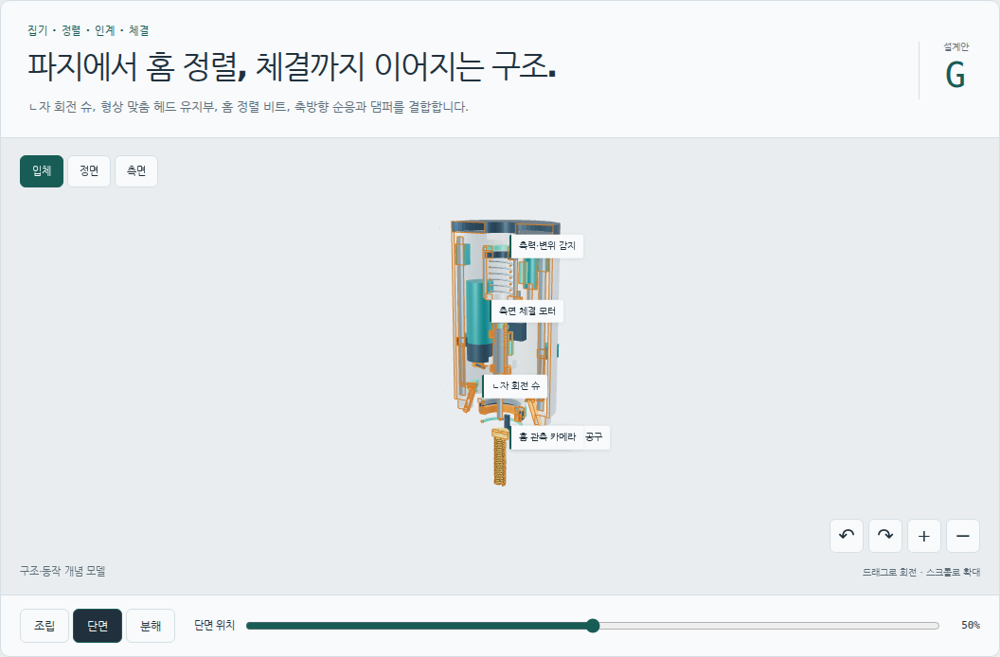 | 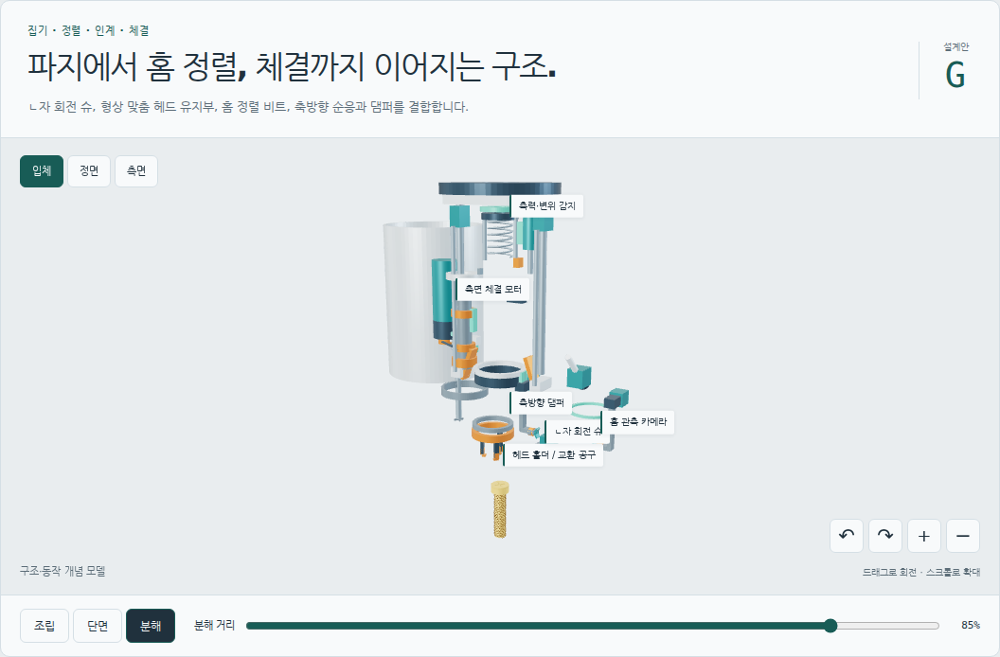 |

## 공통 치수와 단위

| 항목            | 모델 값     | 의미                                                 |
| --------------- | ----------- | ---------------------------------------------------- |
| 몸체 배치 기준  | Ø140×210 mm | 외장 카메라·돌출 집게 제외, 구매 부품 보증 외형 아님 |
| 노즈 길이 기준  | 18 mm       | 집게·볼트의 돌출 길이는 별도                         |
| 헤드 밑 파지점  | 2.5 mm      | 중력 회전을 위한 공통 피벗 위치                      |
| 헤드 인입       | 24 mm       | 지정된 요크 이동                                     |
| 집게 수납       | 36 mm       | 벌림 이후의 추가 수납 이동                           |
| 홀더 후퇴       | 6 mm        | 베어링·저널·홀더 캐리어의 동반 이동                  |
| C·D·G 압축 표현 | 최대 2 mm   | 센서 입력으로 결정하지 않는 값                       |
| 한 사이클       | 70초        | 설명용 시간표, 생산 사이클타임 아님                  |

모델 내부 길이는 mm이며 최상위 그룹이 0.001을 곱해 m로 바꾼다. 공구 +Z는 작업물 방향이다. 볼트 계산에서는 헤드 밑면을 z=0, 끝 방향을 +z로 둔다. `BoltSpec` 길이는 m이므로 계산할 때 mm로 변환한다.

| 프리셋 | 몸통 지름 d | 몸통 길이 L | 헤드 대변 s | 헤드 높이 k |  피치 p |
| ------ | ----------: | ----------: | ----------: | ----------: | ------: |
| M6×20  |        6 mm |       20 mm |       10 mm |        4 mm |    1 mm |
| M8×35  |        8 mm |       35 mm |       13 mm |      5.3 mm | 1.25 mm |
| M10×50 |       10 mm |       50 mm |       17 mm |      6.4 mm |  1.5 mm |

이 표는 코드의 프리셋이다. 같은 호칭 지름의 모든 볼트가 이 헤드 치수를 쓴다는 뜻은 아니다. F·G의 원형 십자·일자 헤드도 비교를 위해 같은 크기 변수를 사용한다. 실제 PH 번호, 일자 날 폭·두께, 홈 깊이와 표준 공차는 선정하지 않았다. 표시된 홈과 비트는 맞물림을 설명하는 단순 형상이며 표준 PH의 테이퍼 면을 정확히 재현한 가공 형상이 아니다.

## 지지 구조와 작업대 기준

몸체 프레임은 FR3 플랜지 어댑터에 연결한다. 인입 모터와 리드스크루는 프레임에 고정하고 이송 너트와 두 직선 가이드의 베어링이 집게 요크를 움직인다. 집게 벌림은 요크에 고정한 실린더의 피스톤·로드와 횡방향 가이드로 표현한다. 손가락·로드·가이드의 길이는 일정하며 부품을 늘여 접촉을 만드는 방식은 쓰지 않는다. A–D·F에는 회전축 서보를, E·G에는 중력 회전 중 분리하는 클러치와 수직 보정·무부하 복귀를 맡는 서보를 둔다.

머리 홀더의 베어링·저널·브레이크는 같은 후퇴 캐리어에 연결한다. 유지턱은 56–58초에 벌어지고 캐리어는 58–59초에 6 mm 후퇴한다. 이때 구동축과 소켓·비트는 독립적으로 체결을 계속한다. 홀더만 베어링에서 빠져나오는 구조가 되지 않도록 지지부도 함께 이동한다. 비트·소켓의 축방향 이송은 키 결합과 추력 베어링을 통해 회전 전달과 양립하도록 배치했다.

작업대, 혼합 볼트 무더기를 담은 통과 체결 작업판은 월드 좌표에 고정한다. 선택한 상단 볼트는 0–5초에 다른 볼트 위에 놓여 있고 5초에 공구가 집어 든다. 머리와 몸통을 받치는 물체도 볼트이며 별도의 픽업 받침대를 쓰지 않는다. 공구가 5–8초에 수직으로 인출한 뒤 통 테두리 위에서 볼트를 세운다. 63초부터 볼트는 작업물에 남고 공구만 이탈한다. 이 경계에서 볼트의 위치와 방향이 이어지도록 변환을 계산한다.

무더기는 크기가 다른 볼트의 접촉 배치를 고정한 장면이다. 규격 선택은 집을 볼트의 규격을 뜻한다. 주변 볼트가 재배열되는 접촉 동역학, 실시간 영상 기반 후보 선택과 반복 피킹은 구현하지 않았다. 실제 작업에서는 상단 노출부와 양쪽 집게의 진입 공간을 확인하고 가려졌거나 끼인 후보는 건너뛰어야 한다. 현재 간섭 검사는 화면의 선택된 볼트와 정해진 경로를 대상으로 한다.

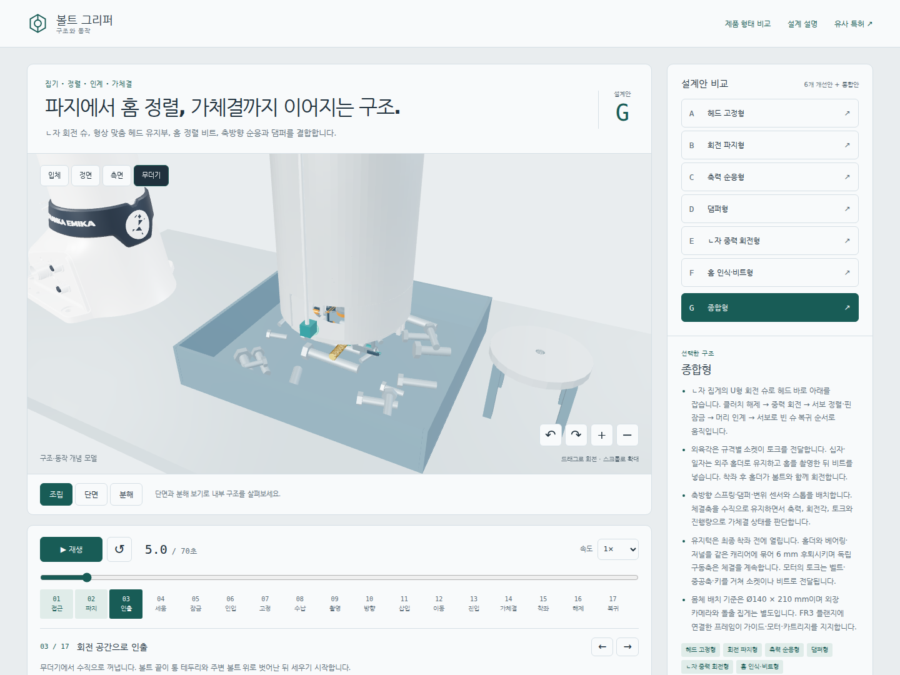

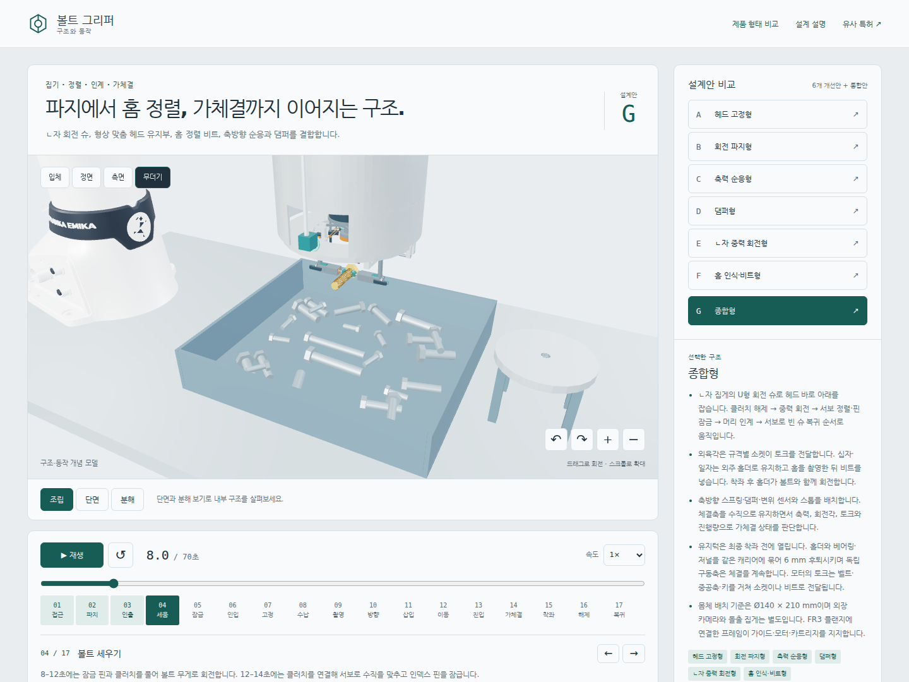

## A: 머리 유지와 토크 전달

육각 소켓은 헤드 면과 맞물려 토크를 전달하고 머리 밑 유지턱은 축방향 이탈을 막는다. 소켓 대변은 프리셋별로 교환한다. 화면에서 M6를 M10으로 바꾸는 것은 자동 카트리지 교환 동작이 아니다. 유지턱은 전단·굽힘 강도와 해제 하중을 별도로 계산해야 한다.

Wera는 두 개의 스프링 볼로 볼트와 너트를 유지하는 소켓을 판매한다. 유지 방식의 제조 사례이며 현재 유지턱의 로봇 가속도·토크·수명을 보증하는 자료는 아니다. 모델에는 분할 유지턱을 표현했고 해당 제품의 볼 구조를 그대로 복제하지 않았다. [Wera 유지 기능](https://www.wera.de/en/tools/belt-a-1-zyklop-socket-set-with-holding-function-1-4-drive)

인계는 머리 위치 확인→유지부 체결 확인→몸통 집게 해제 순이어야 한다. 화면에서는 22–22.1초에 양쪽 슈를 각각 0.15 mm 풀고 22.1–22.3초에 2 mm 내린 다음 완전히 벌린다. 머리 유지턱과 U형 패드가 스치던 구간을 이 순서로 분리했다. 체결 중에는 나사산이 볼트를 유지할 만큼 들어갔음을 확인한 뒤 유지턱을 열고 후퇴시킨다. 최종 착좌 때 유지턱이 머리와 작업면 사이에 끼면 목표 토크에 도달해도 잘못된 체결이 된다.

소켓과 외주 유지부의 접촉 높이는 분리했다. 현재 모델은 소켓 하단을 z=−1.6 mm에, 유지 접촉면을 z=−1.25~0 mm에 둔다. 인접 높이 사이의 간격은 0.35 mm다. 유지부 지지는 소켓 바깥으로 돌리고 해제 시 반경 방향 벌림 이후 축방향 후퇴가 이어지도록 했다. 이 간격은 모델 배치값이며 제조 공차·처짐·전 회전각의 간섭 검증을 대신하지 않는다.

## B: 회전하는 접촉 슈

B는 U형 접촉면과 헤드 밑 걸림턱을 가진 두 슈로 볼트를 잡는다. 회전축과 같은 축의 서보가 슈와 볼트를 함께 세운다. A·C·D·F도 같은 구동 방식을 쓴다. 두 축이 어긋나면 볼트가 비틀리거나 베어링이 구속될 수 있으므로 축 평행도, 양쪽 파지력 차이와 조립 유격을 관리해야 한다. 슈는 자세 전환을 맡고 최종 체결 토크는 받지 않는다.

B·E·G의 각 U형 슈에는 파지 방향을 기준으로 ±28°에서 볼트 원통에 접하는 두 평면 패드를 둔다. 규격별 몸통 지름에 맞춘 기하 배치이며 하중·마찰·접촉압을 실측한 결과는 아니다. 아래 두 접촉면 근사와 별도로 네 패드의 접촉각과 하중 분배를 검토해야 한다.

두 접촉면의 단순 마찰 파지에서는 `2 μ N ≥ S m(g + amax)`로 필요한 힘을 검토할 수 있다. N은 손가락 하나의 법선력[N], μ는 마찰계수, S는 안전계수, m은 질량[kg], g와 amax는 중력과 보수적으로 잡은 이송 가속도[m/s²]다. 손가락 돌출 길이에 따른 허용 모멘트도 확인해야 한다. 이 식은 두 접촉면이 비슷한 하중을 나눈다는 가정이며 나사산 접촉·오일·진동의 상세 해석을 대신하지 않는다. [SMC 그리퍼 선정 자료](https://ca01.smcworld.com/catalog/Electric-en/pdf/Electric-LEH-ABS-ModelSelection_en.pdf)

걸림턱이 받치더라도 슈·핀·손가락의 강도 검토는 남는다. 회전할 때 핀을 빼고 목표 위치에서 결합을 확인해야 한다. Ganter의 인덱싱 플런저는 형상 잠금과 위치 감지의 제조 사례다. 현재 화면의 핀 위치는 시간표로 정하며 실제 검출 신호가 아니다. [Ganter 잠금 핀](https://www.ganternorm.com/en/products/3.1-Indexing-locking-blocking-with-pins-and-ball-shaped-elements/Indexing-plungers)

## C: 축력 순응과 수직 자세

체결축을 구멍 축에 맞추는 일과 힘을 제한하는 일은 별도다. 손목 링크가 기울어져도 공구축은 수직으로 둘 수 있지만 강체 연결을 따라 누름 힘은 전달된다. 실제 로봇에서는 공구 좌표계, 질량·무게중심, 목표 구멍 좌표계를 교정해야 한다. 현재 화면은 FR3의 7관절 체인에서 관절 제한을 적용한 역기구학으로 플랜지 위치와 방향을 맞춘다. 공구는 실제 플랜지 변환에 연결한다. 이 계산에는 질량·관성·관절 속도·동역학과 전체 링크의 충돌 회피가 포함되지 않으므로 실기 실행 궤적으로 사용할 수 없다.

C는 스핀들 축방향 가이드, 예압 스프링, 힘·변위 감지와 과행정 스톱을 표현한다. 회전 반력은 키와 프레임이 받고 순응은 가이드 방향으로 허용하는 구상이다. 저항은 `Fz = Fpreload + kz x + cz ẋ + Ffriction`으로 근사할 수 있다. 힘은 N, x는 mm, kz는 N/mm, ẋ는 mm/s, cz는 N·s/mm다. C의 별도 댐퍼가 없는 경우에는 해당 감쇠항을 제외해 다룬다.

검토 예시로 kz≈1 N/mm, 예압 1–2 N, 사용 행정 4–6 mm를 가정하면 정적 끝단 힘은 약 5–8 N이다. 이는 부품 선정값이나 M6–M10 합격 기준이 아니다. 화면의 2 mm 압축도 이 식의 계산 결과가 아니다. 스톱에 닿으면 추가 로봇 하중이 강체 경로로 전달되므로 그 전에 이송을 멈춰야 한다. 실제 DEPRAG 체결 모듈도 힘·속도·위치 조정과 깊이 감지를 결합한다. [DEPRAG E-SFM](https://www.deprag.com/en/automation/screwdriving-units/e-sfm.html)

공구 안에서 머리를 잡고 비트로 누르는 힘은 비트→볼트→홀더→하우징 내부에서 상쇄된다. 손목 F/T만으로 착좌 힘을 직접 읽을 수 있다고 가정하면 안 된다. 비트 축의 직렬 센서 또는 교정된 스프링 변위 감지가 필요하다. 외부 구멍·작업물에 접촉한 뒤에는 손목 센서로 외력을 감시할 수 있다. 비트가 내려간 원인이 홈 착좌인지 볼트 미끄러짐인지 구분하려면 머리 유지와 상대 진입 깊이를 함께 확인해야 한다.

횡방향·기울기 오차에는 RCC 같은 추가 순응 구조를 검토할 수 있으나 현재 A–G에 구현하지 않았다. ATI는 삽입점 근처의 순응 중심, 과행정 핀, 수평 사용 시 처짐과 잠금 옵션을 설명한다. 축방향 스프링만으로 같은 기능이 생기지는 않는다. [ATI RCC](https://www.ati-ia.com/products/compliance/Compensator_product_desc.aspx)

## D: 감쇠와 충격

D는 축방향 스프링과 병렬 댐퍼를 배치한다. 스프링은 위치 복귀를, 댐퍼는 운동 에너지 소산을 맡는다. 이상적인 점성 댐퍼의 힘은 `Fd = cz ẋ`이므로 정지 상태의 누름 힘을 제한하지 않는다. 실제 부품에는 씰 마찰과 온도 의존성도 있다. 댐퍼에 안내 기능까지 맡기지 말고 가이드와 베어링으로 횡하중을 지지해야 한다. [ACE 회전 댐퍼 설치 자료](https://www.ace-ace.com/media/ace_pim/documents/ACE_FRT-G2_OPERATING-MOUNTING_EN_21_22_0019.PDF)

충격 에너지는 이동부의 `E = ½ meff v² [J]`와 부품의 1회·시간당 허용 에너지를 비교해 검토한다. meff는 접촉 방향 유효 질량[kg], v는 접근 속도[m/s]다. 볼트 외에 움직이는 스핀들·모터·로봇도 영향을 준다. 모델은 스프링 길이와 댐퍼 로드의 상대 이동을 표현하지만 실제 감쇠계수·충격 응답을 풀지 않으므로 피크 힘 감소율을 제시할 수 없다.

중력축에 큰 힌지 댐퍼를 그대로 달면 볼트가 돌지 못한다. 아래에서 계산한 M6 볼트만의 최대 중력토크는 약 0.000207 N·m다. 0.1 N·m 저항은 이 값보다 약 483배 크다. 이 비교는 토크 범위를 먼저 확인해야 한다는 뜻이다. [ACE FFD 자료](https://www.acecontrols.com/media/msimages/pdf/ACE_FFD_Operating-Mounting_EN_21_22_0019.pdf)

## E: 중력 세우기와 빈 슈 복귀

E·G는 회전축의 클러치를 해제하고 피벗을 헤드 밑 2.5 mm에 둔다. 무게중심이 피벗보다 몸통 쪽이어야 끝이 아래로 향한다. 이전 검토의 14 mm 파지점에서는 M6·M8의 무게중심이 피벗보다 헤드 쪽이므로 원하는 방향을 보장하지 못한다.

몸통을 균일 원통, 헤드를 육각기둥으로 근사한다. 밀도는 `ρ = 7.85×10⁻⁶ kg/mm³`이며 나사산·모따기·홈은 생략한다.

`Vs = π d² L / 4 [mm³]`

`Vh = √3 s² k / 2 [mm³]`

`m = ρ(Vs + Vh) [kg]`

`zCOM = [Vs(L/2) − Vh(k/2)] / (Vs + Vh) [mm]`

`l = (zCOM − zpivot)/1000 [m]`, `zpivot = 2.5 mm`

| 규격   | 근사 질량 |      zCOM |         l | 볼트만의 최대 중력토크 mgl |
| ------ | --------: | --------: | --------: | -------------------------: |
| M6×20  |   7.158 g |  5.441 mm |  2.941 mm |                 0.207 mN·m |
| M8×35  |  19.900 g | 11.334 mm |  8.834 mm |                 1.725 mN·m |
| M10×50 |  43.401 g | 16.830 mm | 14.330 mm |                 6.101 mN·m |

표는 육각 헤드의 자체 계산이며 원형 십자·일자 헤드의 실측값이 아니다. 현재 `boltMassProperties()`도 헤드 선택과 무관하게 이 육각 근사를 쓴다.

수직을 기준으로 기울기를 θ[rad]로 잡으면 볼트 복원 토크는 `τg = −mgl sinθ [N·m]`다. 실제 회전은 `J θ̈ + cθ θ̇ + τfriction + τspring = −mgl sinθ`로 검토할 수 있다. J는 볼트와 슈의 관성모멘트[kg·m²], cθ는 회전 감쇠계수[N·m·s/rad]다. 슈의 편심 무게도 우변에 더해야 한다. M6는 구동 토크가 작으므로 슈 질량 균형과 파지 하중이 걸린 베어링의 기동마찰을 먼저 확인해야 한다. SKF도 구름·미끄럼·씰·윤활 손실을 나누며 기동 시 미끄럼과 씰의 영향을 다룬다. [SKF 베어링 마찰](https://evolution.skf.com/using-a-friction-model-as-an-engineering-tool-3/)

현재 `gravityAngle()`은 균형 잡힌 슈를 가정하고 볼트만의 근사 관성으로 감쇠 진자를 계산한다. 간격은 1/240초, 감쇠계수는 `1.4√(mglJ)`다. 정지 마찰·슈 관성은 제외하고 수직을 넘는 각도를 제한한다. 12–14초의 마지막 구간은 서보 정렬을 시간 보간으로 표현하므로 화면의 90° 도달이 중력만으로 정렬된다는 증거는 아니다.

모델에서는 무더기에서 인출한 뒤 8–12초에 클러치와 잠금 핀을 해제해 볼트를 중력으로 회전시킨다. 실제 통에서 사용할 때도 벽과 주변 볼트에서 벗어나야 한다. 수직 부근은 중력토크가 0에 가까우므로 12–14초에 클러치를 연결해 서보로 남은 각도를 맞춘다. 회전축에서 벗어난 인덱스 핀이 90° 위치에 결합하면 잠금을 확인한다. 머리를 인계하고 집게를 벌린 뒤 24–25초에 클러치를 연결한 상태로 회전축 서보가 빈 슈를 가로 자세로 되돌린다. 고정 복귀 캠은 인입 가이드의 이동 공간과 충돌하므로 사용하지 않는다.

잠금 핀은 축 중심이 아닌 인덱스 원판의 구멍에 결합해 회전을 막는다. 중력 회전 중에는 서보의 저항이 슈로 전달되지 않도록 클러치를 풀어야 한다. 화면의 복귀 각도와 클러치·핀 상태는 시간표로 정하며 실제 잔류 마찰·정렬 힘·끼임·반복 정밀도는 별도 검증 대상이다.

## F: 홈 관측과 비트 착좌

외육각은 교환 소켓, PH·일자는 해당 홈에 맞는 비트 카트리지를 쓴다. 유형과 크기는 작업 규격으로 지정해야 한다. 십자 영상만으로 PH와 PZ를 같은 규격으로 처리하면 안 된다. PH의 경사진 면은 비트를 밀어내는 축방향 힘을 만들며 PZ의 접촉면은 다르다. [PB Swiss PH·PZ 비교](https://www.pbswisstools.com/en/news/detail/phillips-and-pozidriv-cross-head-screws-explained-in-simple-terms)

비트를 후퇴시키고 머리 뒤쪽의 사선 카메라로 홈을 본다. 현재 렌즈 중심은 공구 좌표 [0, 72, −32] mm이며 몸체 바깥 브래킷에 고정한다. 홀더 섹터 사이로 시선이 지나도록 배치했다. 측면 모터와 열린 중앙 통로는 후방 시야를 확보하기 위한 구조다. 중앙 광선의 통과 여부와 별도로 홈 전체의 시야, 깊은 홈의 가림, 규격별 초점·해상도·왜곡과 공구축 교정을 확인해야 한다. 렌즈와 카메라 제품은 선정하지 않았다.

카메라 렌즈 둘레의 링 조명은 반사 금속에서 링 자체가 밝게 비칠 수 있다. 확산판과 조명·렌즈의 교차 편광을 비교하고 기름·도금·흠집이 있는 시편으로 확인해야 한다. 화면의 조명 고리와 시야선은 광학 효과를 계산하지 않는다. [Edmund 링 조명](https://www.edmundoptics.com/knowledge-center/application-notes/illumination/brightfield-illumination-with-ring-lights-for-machine-vision/), [편광 적용](https://www.edmundoptics.com/knowledge-center/application-notes/illumination/successful-light-polarization-techniques/)

일자는 180°, PH 십자는 90°, 육각은 60° 주기로 같은 방향이다. 대응 방향 중 현재 각도와 가장 가까운 각도를 선택하되 홈 유형을 알아냈다는 전제가 필요하다. 모델의 초기 헤드각 38°는 미리 지정한 값이며 카메라 추정 결과가 아니다.

외육각 소켓도 `nearestDriveAngle()`의 60° 대칭 계산을 따른다. 27–29초에 소켓 방향을 먼저 맞추고 29–31초에 삽입한다. 방향 정렬과 축방향 삽입을 순서대로 보여주는 애니메이션이며 실제 접촉 탐색의 성공 판정은 아니다.

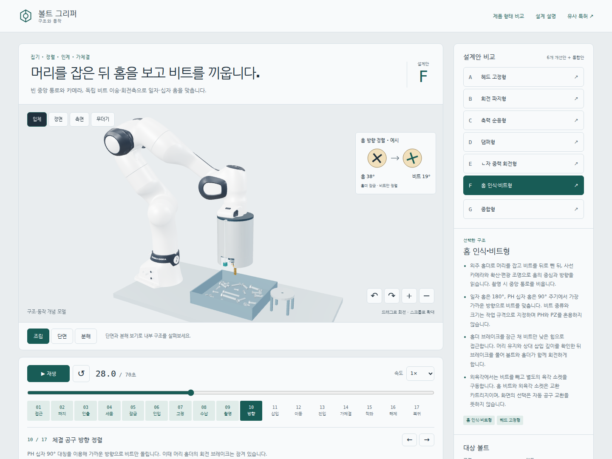

순서는 머리 유지→비트 후퇴와 촬영→방향 정렬→낮은 힘으로 접근→상대 깊이 확인→홀더 브레이크 해제다. 이후 홀더는 볼트와 함께 돌아야 한다. 프레임에 고정한 홀더가 머리를 꽉 잡은 채 비트만 돌리면 체결되지 않는다. 실제로는 홀더 회전 저항과 유지력을 측정하고 비트 축의 힘·각도·토크를 감시해야 한다.

진공 슬리브는 외주 죠의 개방 공간을 줄일 수 있는 대안이지만 머리에 맞는 슬리브와 누설·압력 확인이 필요하다. Robotiq는 진공과 순응 슬리브를 사용하며 공개 제품 범위는 M2.5–M5다. 방법의 사례이며 M6–M10 적용을 보증하지 않는다. [Robotiq Screwdriving](https://robotiq.com/solutions/screwdriving)

## G: 인계·체결·복귀 조건

| 단계             | 실물에서 확인할 조건                   | 실패 시 처리                    |
| ---------------- | -------------------------------------- | ------------------------------- |
| 파지·인출        | 한 개 파지, 유지력, 회전 공간          | 인입 전 재파지                  |
| 세우기·잠금      | 목표 각도와 핀 결합                    | 미완료 상태의 인입 금지         |
| 머리 인계        | 위치와 유지부 체결                     | 몸통 집게 유지                  |
| 수납·원점 복귀   | 빈 슈 복귀, 집게 간격                  | 다음 단계 정지                  |
| 영상·정렬        | 규격 일치, 가림·포화 없음              | 비트 후퇴 후 제한된 재촬영      |
| 착좌             | 머리 유지와 상대 깊이, 힘·토크 범위    | 후퇴·재정렬, 횟수 제한          |
| 초기 나사산 진입 | 낮은 속도, 회전 대비 진행량            | 조기 토크 상승 시 정지          |
| 유지턱 해제      | 나사산 유지, 작업면 접근 전            | 유지가 불명확하면 정지          |
| 가체결 종료      | 머리 접근 깊이, 낮은 힘·토크 종료 한계 | 조기 걸림 시 정지와 정해진 복구 |
| 공구 해제        | 작업물에 볼트 잔류, 공구 분리          | 공구 상승 정지와 상태 확인      |

이 표는 실제 제어기의 요구 조건이다. 웹에서는 단계가 시간에 따라 넘어가며 센서로 전이를 허용하거나 실패를 검출하지 않는다. 압축·회전·작업물 상대 이동으로 실제 접촉 결과를 추론하지 않는다.

회전량은 36–39초의 초기 진입 2회전과 39–60초의 나머지 회전을 합산한다. 최종 총회전 수는 `L/p`이며 화면의 축방향 진입량도 같은 회전량에서 계산해 최종 길이 L과 맞춘다. 60초 이후에는 추가 회전 없이 공구 해제를 준비한다. 실물에서는 고정 회전 수로 끝내지 않고 머리 높이·진행량과 낮은 힘·토크 한계로 종료한다. L과 p는 같은 길이 단위를 쓴다. 이 관계는 시간표의 일관성을 뜻하며 실제 나사산 물림이나 유효체결길이를 검증한 결과는 아니다.

작업물은 고정 Ø11 mm 구멍 대신 선택한 볼트 지름에 0.1 mm를 더한 공칭 구멍과 피치에 맞춘 나선 표시를 쓴다. M6에서는 구멍 Ø6.1 mm가 원형 헤드 Ø10 mm보다 작아 머리가 통과하지 않는다. 이 구멍과 나선은 착좌를 설명하는 형상이며 실제 암나사 치형·공차·유효체결길이의 가공 모델은 아니다.

단일 시작 나사가 정상적으로 물린 뒤에는 `Δz = p Δθ/(2π)`로 진행을 비교할 수 있다. p와 Δz는 같은 길이 단위, Δθ는 rad다. 초기 유격·탄성 변형·바닥 닿음·최종 착좌는 별도로 다룬다. 초기부터 토크가 높고 진행이 부족하면 비뚤어진 나사산 진입을 의심한다. 토크·각도 창은 cross-threading·재체결·나사산 손상을 찾는 데 쓰이지만 이것만으로 원인을 확정하지 않는다. [Atlas Copco 각도 감시](https://www.atlascopco.com/en-us/itba/expert-hub/articles/back-to-the-basics-angle-monitoring-and-control)

토크 경로는 모터→감속부→풀리·벨트→중공 구동축→키 결합 이송축→소켓 또는 비트→볼트다. 반력은 베어링·키·프레임과 로봇 장착부가 받는다. 회전 슈·댐퍼·카메라 브래킷에 체결 반력을 맡기지 않는다. 가체결의 종료 한계는 재질·윤활·상대 부품과 실제 걸림 시험으로 정한다. 낮은 전류만으로 정상 진입을 보증할 수 없으므로 진행량과 함께 판정한다. 기존 프리셋의 8·20·40 N·m 예시를 검증된 목표값으로 전용하지 않는다.

## 제작·조립·정비

몸체·커버는 절삭 알루미늄, 소켓·유지턱·인덱스 원판·핀은 교환 가능한 강재 부품으로 나누는 방안을 검토한다. 재질·열처리·표면처리는 미선정이다. 베어링 끼워맞춤, 축 어깨·고정링, 키·스플라인 치수, 나사와 풀림 방지 방법을 상세 도면으로 확정해야 한다. 화면의 실린더와 링은 구매 부품의 정격을 나타내지 않는다.

외장을 분리하면 핀·카트리지 교환, 카메라 재초점, 벨트 장력 조정, 윤활과 칩 제거가 가능해야 한다. 카트리지에는 규격과 방향을 표시하고 잘못 장착된 상태에서는 구동하지 않도록 한다. 슈 교환 후에는 축 정렬과 원점을 다시 확인한다. 패드는 오일·나사산 마모를 점검하고 교체할 수 있어야 한다.

프레임의 기준면·위치결정 핀과 센서 브래킷은 조립 반복 정밀도를 결정한다. 배선·호스를 추가할 때는 이동 행정, 굽힘 반경, 회전부 감김과 케이블 고정 공간도 필요하다. 모델에는 전체 배선·커넥터·모든 체결 나사와 조립 공차가 반영되지 않았다. 분해 그림도 실제 조립 순서나 공구 접근 가능성을 계산한 결과는 아니다.

충돌 검토는 볼트 회전 궤적, 최대 벌림, 인입, 유지턱 개방·후퇴, 최대 압축과 공구 이탈까지 포함해야 한다. 소켓과 외주 홀더, 렌즈와 노즈 베어링, 카메라와 수납 집게는 우선 확인할 조합이다. 통 벽과 이웃 볼트에 대한 선택 경로의 메시 간섭을 검사한다. 이 검사는 장면에 놓인 고정 무더기를 대상으로 하며 FR3 전체 링크의 충돌 회피나 실제 통의 임의 배치를 보증하지 않는다.

## 화면 구성의 판단

공개 진입점 `/`와 `/r11.html`은 같은 일곱 안을 연다. `revision=head|retention|compliance|damping|gravity|drive|integrated`와 `head=hex|phillips|slotted`로 선택을 공유한다. F·G만 홈 비트를 지원하며 A–E는 외육각으로 맞춘다. 이름과 적용 구조를 함께 보여 E·F의 의존 관계를 확인할 수 있게 했다.

FR3에 연결된 공구와 고정 작업대를 보여주고 같은 위치에서 조립·단면·분해를 전환한다. 단면은 이동 가능한 절단면과 교차 윤곽을 사용한다. 분해 보기는 베어링·고정부를 포함한 하위 조립체를 분리해 배치를 설명한다. 내부 구조를 읽을 때는 재생을 멈추며 단계 이름·설명, 이전·다음 버튼과 타임라인을 함께 둔다.

드래그 외에도 시점 회전·확대 버튼을 제공하고 선택 상태와 현재 단계에 접근성 속성을 둔다. 렌더링 실패 시 재시도할 수 있다. 가상 힘·토크 계기를 실측처럼 표시하지 않는다. 키보드·모바일·스크린리더 동작과 읽기 편의는 브라우저 검사와 사용자 확인으로 평가해야 한다.

## 검증 범위와 남은 확인

| 구분      | 현재 근거                          | 미검증 항목                            |
| --------- | ---------------------------------- | -------------------------------------- |
| 구조·동작 | 형상·시간표 코드 대조              | 제조 공차, 실제 구동·센서 배선         |
| 중력 회전 | 볼트 근사 질량·무게중심·토크       | 슈 질량, 기동마찰, 저온·오염·반복 복귀 |
| 비트 정렬 | 대칭각과 홈·비트 형상              | 영상 인식, PH 규격 형상, 착좌 성공률   |
| 축력·감쇠 | 배치·계산식                        | 힘 교정, 댐퍼 특성, 충격 응답          |
| 체결      | 회전·진행 순서                     | cross-thread 검출, 토크·축력 실측      |
| 강도·수명 | 하중 경로 검토                     | FEA, 피로, 마모, 낙하·과부하 시험      |
| 로봇 연동 | FR3 7관절 IK·플랜지 연결·고정 지그 | ROS 제어, 전체 충돌, 동역학과 페이로드 |
| 웹        | 조작·단면·분해 기능                | 실물 성능은 웹 검사로 판정할 수 없음   |

소프트웨어 확인 명령은 `npm run typecheck`, `npm test`, `npm run test:browser`, `npm run build`다. 이 문서는 명령 실행만으로 기계적 합격을 선언하지 않는다. 실물 검증은 단일 볼트의 파지·중력 회전·인계·복귀를 측정한 뒤 저속 비트 착좌와 나사산 진입, 가체결 종료 조건과 반복 수명 순으로 진행하는 것이 적절하다.
